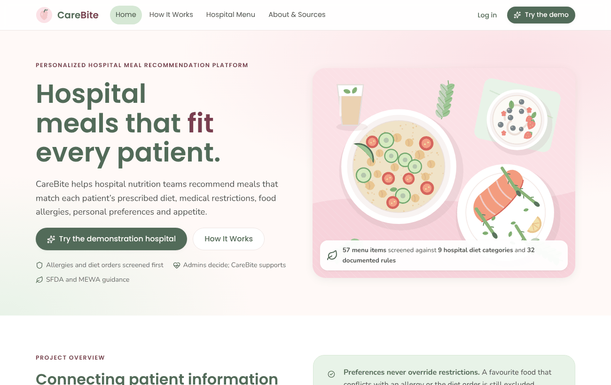
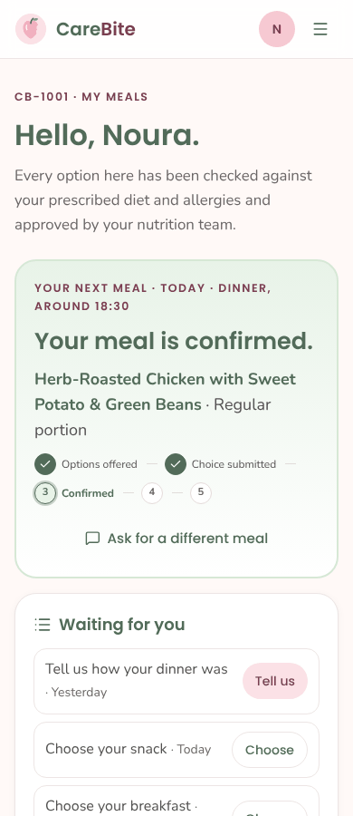
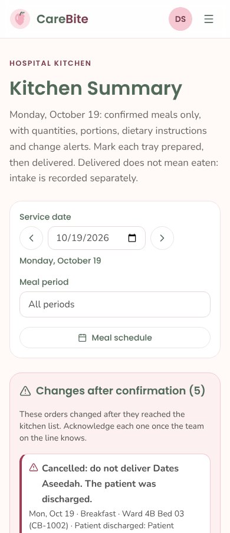
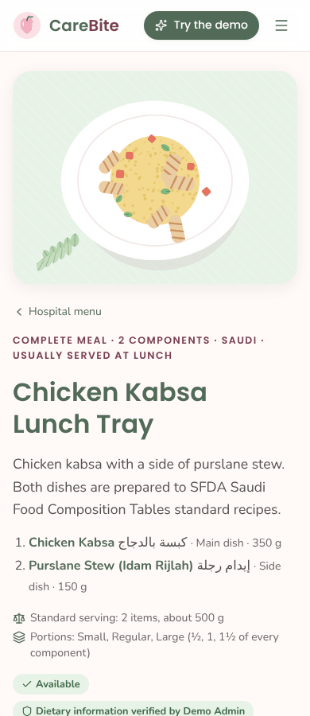
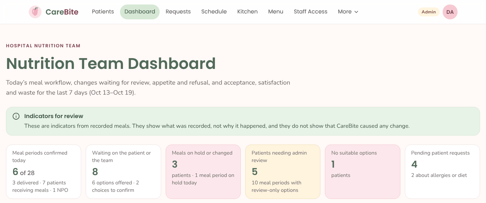
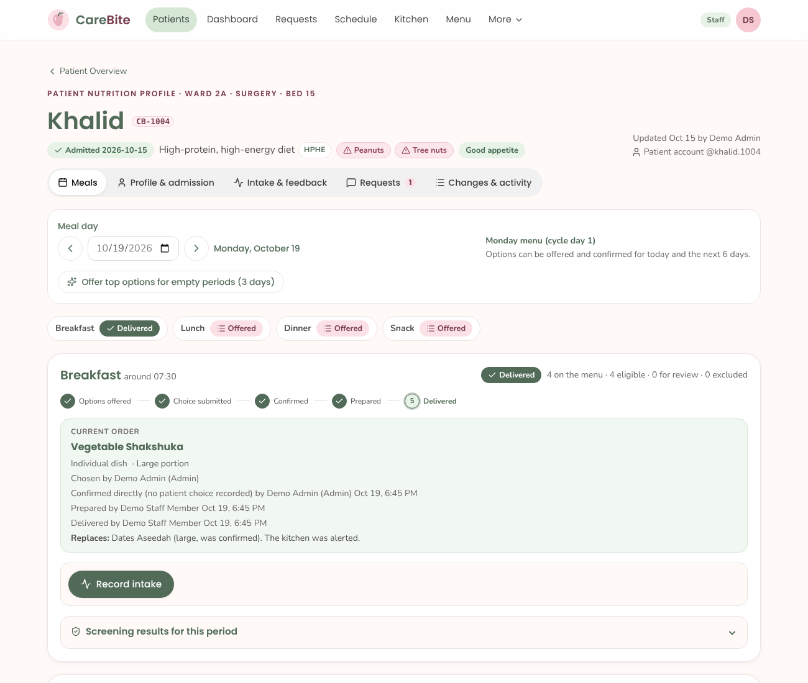

# Wastelimiting · CareBite

**CareBite** is a personalized hospital meal recommendation platform: a university Health Informatics project that helps hospital nutrition teams serve patients meals they can safely eat and are likely to finish, so that less food is wasted. It matches each meal on the hospital menu to the patient's prescribed diet, medical restrictions, food allergies, preferences and appetite. It then follows every meal from the offer to the tray, and records what was actually eaten, refused or left over.

Every food and health rule is based on Saudi government guidance: the Ministry of Health, the Saudi National Diabetes Center, the Saudi Food & Drug Authority (SFDA), the Ministry of Environment, Water and Agriculture (MEWA) and the General Food Security Authority (GFSA).

**Project Development Team:** Lana Fahad Alhari · Nebras Almutairi · Alhanouf Aldubyan · Shumua Alharbi

> **Medical disclaimer.** CareBite is an educational Health Informatics project designed to demonstrate personalized nutritional decision support. It does not diagnose medical conditions, replace professional medical advice, or guarantee clinical outcomes. Meal suggestions depend on the available data and reviewed dietary rules. Users with complex medical conditions, prescribed diets, or uncertain allergy information should consult a qualified healthcare professional.

All patients, staff and records in this project are fictional (synthetic demonstration data).

<p align="center">
  
</p>

<p align="center">
  
  
  
</p>

---

## Why: limiting hospital food waste

Hospital meals that do not fit a patient (wrong diet, an allergen, a disliked food, too large a portion for a poor appetite) are refused or left on the plate. CareBite addresses this at each step:

1. **Screening first.** Meals that conflict with the diet order or allergies are excluded before anything is offered, and meals with incomplete information go to an admin for review. Preferences never bring back an excluded meal.
2. **Choice within safe options.** Patients choose from approved options on their phone. Ranking uses their preferences, past feedback and appetite.
3. **Right-sized portions.** Portions are suggested from the patient's appetite and the portions their diet order permits.
4. **Only confirmed meals reach the kitchen.** The kitchen prepares exact quantities by meal and portion. Changes after confirmation (a new allergy, an unavailable meal, a menu edit) put the order on hold, so nothing unsuitable is cooked or delivered.
5. **Measured outcomes.** Acceptance, the estimated amount eaten, satisfaction and **weighed plate waste (grams)** are recorded separately and shown on the team dashboard. This follows the GFSA National Program to Reduce Food Loss and Waste.

<p align="center">
  
</p>

## Features by role

CareBite has three roles. Every action is authorized by role-based access control (RBAC).

| Role | What they do |
| --- | --- |
| **Patient** | **My Meals**: the next meal and what to do next, approved options with "Why this meal?", choosing a meal, the day and week view, and feedback after delivery. **My Requests**: requests and the team's responses. **My Food Profile**: preferences and appetite, and reporting a diet or allergy change for review. |
| **Staff** | **Patient overview** and nutrition profiles. Offering and confirming eligible meals, recording a patient's choice, cancelling and handling held meals. **Kitchen summary**: quantities, tray tickets, prepared → delivered, and change alerts. Also the meal schedule, recording intake (including weighed waste), editing the menu, answering requests, and admission and discharge. |
| **Admin** | Everything staff can do, plus: clinical information (diet orders, allergies, restrictions), approving meals that need review, verifying menu dietary information, creating and deleting records, and approving staff access and assigning roles. |

The meal workflow is **Options offered → Patient choice submitted → Confirmed by nutrition team → Prepared → Delivered**. Delivered does not mean eaten: intake is recorded separately.

<p align="center">
  
</p>

## Tech stack

- **Next.js 16** (App Router, React 19, TypeScript). Pages are server components; client components use **SWR**, starting from the server-fetched data.
- **better-auth**: email or username with a password and **server-side sessions**. No JWT, and no external auth provider.
- **SQLite** through Node's built-in `node:sqlite`, shared by the domain and better-auth.
- **Tailwind CSS v4** with **shadcn-style components** on **Base UI**, using the CareBite palette.
- **Motion** from [transitions.dev](https://transitions.dev) CSS transitions, installed with its CLI (`npx transitions-dev add --free`).
- The **domain layer** (`domain/`) is plain JavaScript and holds the screening engine, the meal workflow, menu management and RBAC.

## Getting started

Requirements: **Node.js 22.13 or newer**.

```bash
git clone https://github.com/lanafahad1/Wastelimiting.git
cd Wastelimiting
npm install
cp .env.example .env.local
# edit .env.local: set BETTER_AUTH_SECRET to a random value of at least 32 characters,
# for example the output of: openssl rand -base64 32
npm run dev            # http://localhost:3000
```

On first start the database `var/carebite.db` is created and seeded with:
- the hospital menu;
- the SFDA Saudi Food Composition Tables (130 dishes);
- the diet rules;
- the demo accounts;
- a fictional demonstration hospital with 10 patients and 6 days of history.

| Command | What it does |
| --- | --- |
| `npm run dev` | Development server. |
| `npm run build` then `npm start` | Production build and server. |
| `npm test` | Domain, database, RBAC and password-policy tests (37). |
| `npm run test:e2e` | Cross-role browser test, 64 checks. Run it against a freshly seeded server; set `CHROMIUM=/path/to/chrome` if Playwright's browser is not installed. |
| `npm run typecheck` | TypeScript check. |
| `npm run reset-db` | Delete the local database; the next start re-seeds it. |

### Demo accounts (demonstration access only)

All demo accounts use the password `CareBite#2026`, and the login page has one-click buttons. **No identity is verified**: these are shared demonstration accounts, not real credentials.

| Username | Role |
| --- | --- |
| `admin.demo` | Admin |
| `staff.demo` | Staff |
| `noura.1001`, `khalid.1004` | Patients CB-1001 and CB-1004 |

`layla.applicant` is a pending staff access request that `admin.demo` can approve.

## Project structure

```
app/                 Next.js routes (server components), API route handlers, sitemap, robots, OG image
  api/auth/[...all]  better-auth endpoints
  api/[...path]      JSON API for client components (SWR reads and mutations)
  styles/            transitions.dev snippets used by the app
components/
  ui/                shadcn-style primitives on Base UI, wired to the transitions
  cb/                status chips, workflow stepper, diet code toggletips, meal rows, "Why This Meal?"
  forms/             patient profile sections, intake fields, ingredient pickers
  site/, public/, auth/, patient/, patients/, staff/   per-area components
domain/              screening engine, workflow, menu management, RBAC policy, SQLite repository
data/                SFDA SFCT dish values, ingredients, dishes, meals, menu cycle, local production
lib/                 auth configuration, session to actor, API client, SEO, formatting
proxy.ts             per-request CSP nonce, security headers, sign-in redirect
docs/                contributor conventions and screenshots
test/, e2e/          node:test suites and the cross-role browser test
```

## Security and privacy

- **Sessions.**
  - Sessions are stored on the server. The browser holds only an opaque cookie: `HttpOnly`, `SameSite=Lax`, `Secure` over HTTPS.
  - The lifetime is 8 hours, sliding.
  - Sessions are revoked on password change, deactivation and account deletion.
  - Session tokens are never included in JSON responses.
- **Passwords** follow OWASP and NIST guidance:
  - at least 8 characters, with no composition rules;
  - common passwords are refused, as is a password equal to the username or email;
  - hashed with scrypt.
- **Rate limits.**
  - Sign-in allows 5 attempts per minute per IP; sign-up, password change and account deletion allow 5 per 5 minutes.
  - Sign-in gives one generic error message.
  - Limits use the forwarded client IP, so deploy behind a reverse proxy that sets `X-Forwarded-For`.
- **No privilege escalation.** Role, status and the patient link are server-only fields. A staff sign-up is only a request until an admin approves it. Patients join with a one-time link code from the nutrition team.
- **RBAC.**
  - A single policy (`domain/rbac.js`) is checked by pages, the API and every domain operation.
  - Protected areas return a real HTTP 403 to roles without access.
- **CSRF and headers.**
  - Same-origin checks, plus a custom header on API mutations.
  - A strict Content-Security-Policy with a per-request nonce.
  - `X-Frame-Options: DENY`, `nosniff`, `Referrer-Policy`, `Permissions-Policy`, and HSTS in production.
- **Data protection.**
  - Private pages are server-rendered after the permission check, and marked `noindex`.
  - Every change is written to an audit log.
  - No secrets are committed: configuration lives in `.env.local`, which git ignores; see `.env.example`.

## Data sources

- **Nutrition:** the **SFDA Saudi Food Composition Tables (SFCT)**, first edition: laboratory values for 130 traditional dishes.
  - 18 hospital dishes are linked to SFCT entries.
  - Missing values are never estimated, and meals that a rule cannot check go to admin review.
  - 9 published tables that are internally inconsistent are kept as published, and cannot be linked to a dish.
- **Rules:**
  - MOH salt limit (5 g a day), diabetes, kidney disease and gluten-free guidance;
  - the Saudi Diabetes Clinical Practice Guidelines;
  - SFDA's 14 declarable allergens and its "high in fibre" level.
- **Other:**
  - local production figures from MEWA and GASTAT;
  - the GFSA food-waste programme;
  - IDDSI texture levels (no Saudi standard was found).

The full list of sources is on the site's **Data sources & limitations** page.

## Limitations

- **Not production-ready:**
  - no real identity verification or email service;
  - no notifications outside the app;
  - no connection to hospital systems (EHR, admission, pharmacy).
- **Not clinically validated.** The rules follow cited Saudi guidance but have not been validated; a hospital dietetics department would need to review them.
- **Data gaps:**
  - only the 18 SFCT-linked dishes have nutrient values;
  - menu items have no texture levels;
  - dashboard figures describe recorded meals only and do not show cause and effect.

## Acknowledgements

- [SFDA Saudi Food Composition Tables](https://www.sfda.gov.sa/en/news/19089).
- [transitions.dev](https://transitions.dev) CSS transitions, used under its terms (the library itself is not redistributed here).
- [Base UI](https://base-ui.com), [shadcn/ui](https://ui.shadcn.com) patterns, [better-auth](https://www.better-auth.com), [Next.js](https://nextjs.org), [SWR](https://swr.vercel.app) and [Tailwind CSS](https://tailwindcss.com).
